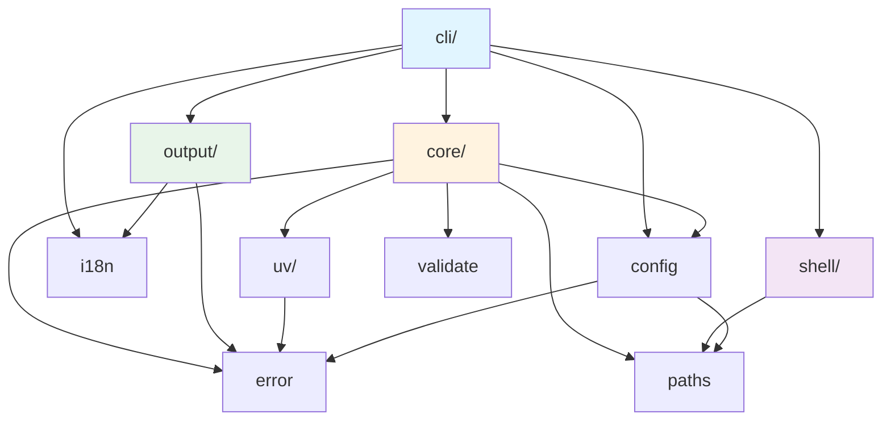
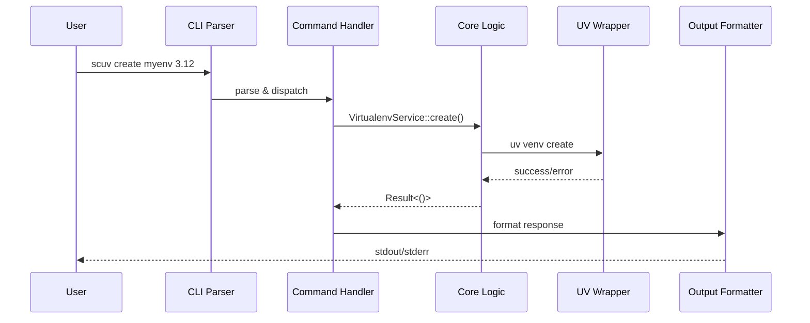
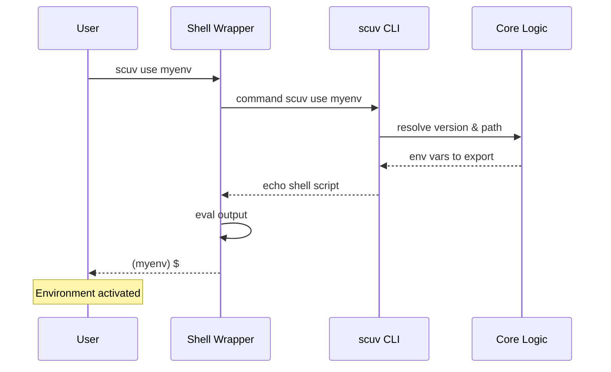
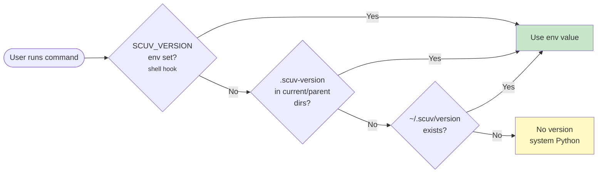
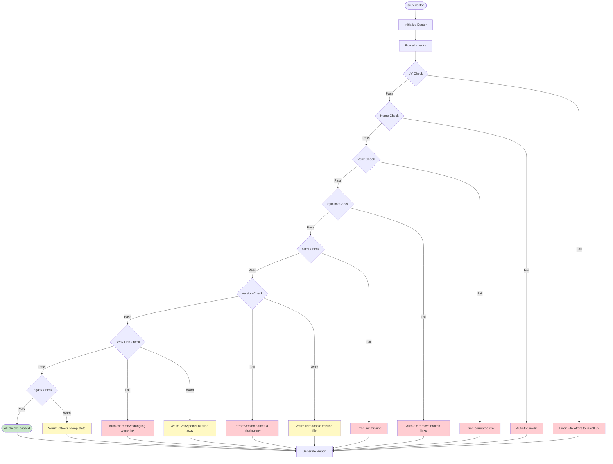
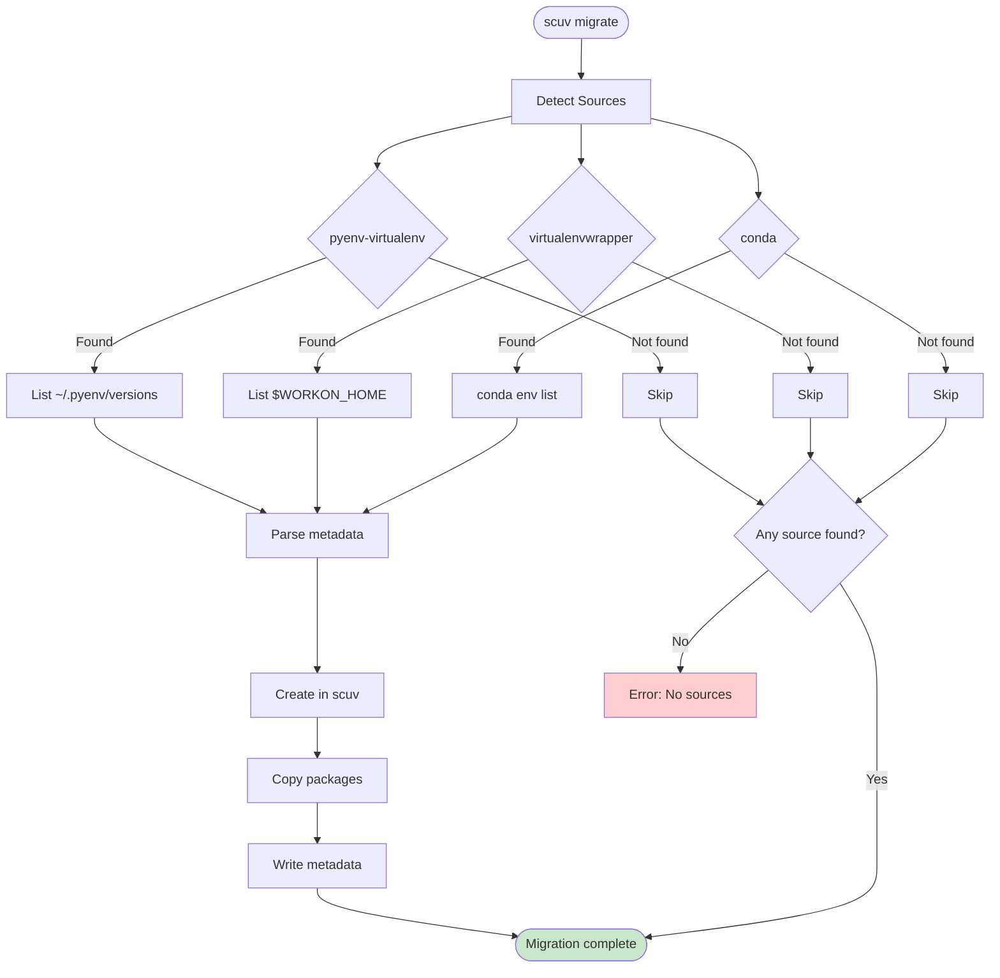

# Architecture

scuv is built in Rust using a modular architecture.

## Module Structure

```
src/
├── cli/              # Command-line interface
│   ├── mod.rs        # Cli struct, Commands enum, ShellType
│   └── commands/     # Individual command handlers
├── core/             # Domain logic
│   ├── metadata.rs   # Virtualenv metadata (JSON)
│   ├── version.rs    # Version file resolution
│   ├── virtualenv/   # Virtualenv entity (mod.rs + tests.rs)
│   ├── doctor/       # Health check system (engine, types, checks/)
│   ├── manifest.rs   # Sync manifest (.scuv.toml, backs `scuv sync`)
│   ├── export_schema.rs  # Export/import schema (backs `scuv export`/`import`)
│   └── migrate/      # Migration from pyenv/conda/virtualenvwrapper
│       ├── mod.rs
│       ├── discovery.rs  # Source detection
│       ├── migrator.rs   # Migration orchestrator
│       └── ...
├── shell/            # Shell integration
│   ├── mod.rs        # Shell module exports & detection
│   ├── common.rs     # Shared shell utilities & macros
│   ├── bash.rs       # Bash init script
│   ├── zsh.rs        # Zsh init script
│   ├── fish.rs       # Fish init script
│   └── powershell.rs # PowerShell init script
├── output/           # Terminal UI and JSON output
│   └── time.rs       # last_used fuzzy-age formatter
├── uv/               # uv CLI wrapper
├── error/            # ScoopError module
│   └── exit.rs       # Exit code policy
├── paths.rs          # Path utilities
├── validate.rs       # Input validation
├── i18n.rs           # Internationalization
└── config.rs         # Configuration management
```

### Module Dependency Graph



## Key Components

### CLI Layer (`cli/`)

- Uses [clap](https://docs.rs/clap) for argument parsing
- `Cli` struct defines global options
- `Commands` enum defines subcommands
- Each command has an `execute` function in `commands/`

### Core Layer (`core/`)

| Module | Purpose |
|--------|---------|
| `doctor` | Health check system with `Check` trait |
| `metadata` | JSON metadata for virtualenvs |
| `version` | Version file discovery and parsing |
| `virtualenv` | Virtualenv entity and operations |

### Shell Layer (`shell/`)

Generates shell scripts for integration:

- `init_script()` - Returns shell initialization code
- Wrapper function for `scuv` command
- Auto-activation hooks
- Tab completion definitions

### Output Layer (`output/`)

Handles terminal output formatting:

- Colored output using [owo-colors](https://docs.rs/owo-colors)
- JSON output for scripting
- Progress indicators with [indicatif](https://docs.rs/indicatif)

### UV Layer (`uv/`)

Wraps the uv CLI for Python/virtualenv operations (`client.rs`, `UvClient`):

- Python installation and removal
- Virtualenv creation
- Version listing
- Package listing and installation
- Cache pruning

`version.rs` holds the minimum supported uv version (`MIN_VERSION`) and the `uv --version`
parser. `install.rs` installs uv for `scuv doctor --fix` only, after the user confirms a plan.
It is crate-private, and `UvClient` never installs anything.

## Design Patterns

### Shell Eval Pattern

The CLI outputs shell code to stdout, which the shell evaluates:

```bash
# User runs
scuv activate myenv

# CLI outputs
export VIRTUAL_ENV="/Users/x/.scuv/virtualenvs/myenv"
export PATH="/Users/x/.scuv/virtualenvs/myenv/bin:$PATH"
export SCUV_ACTIVE="myenv"

# Shell wrapper evaluates this output
eval "$(command scuv activate --shell bash myenv)"
```

This pattern is used by pyenv, rbenv, and other version managers.

### Error Handling

Uses [thiserror](https://docs.rs/thiserror) for error types:

```rust
// Uses thiserror for Error trait derive
// Display impl is manual (not #[error] attributes) for i18n support
#[derive(Debug, Error)]
pub enum ScoopError {
    VirtualenvNotFound { name: String },
    VirtualenvExists { name: String },
    // ...
}

// Manual Display implementation using rust-i18n
impl std::fmt::Display for ScoopError {
    fn fmt(&self, f: &mut std::fmt::Formatter) -> std::fmt::Result {
        match self {
            Self::VirtualenvNotFound { name } => {
                write!(f, "{}", t!("error.virtualenv_not_found", name = name))
            }
            // ...
        }
    }
}
```

### Path Management

Centralizes path logic in `paths.rs`:

- `scoop_home()` - Returns `SCUV_HOME` or `~/.scuv`
- `virtualenvs_dir()` - Returns virtualenvs directory
- `global_version_file()` - Returns global version file path (~/.scuv/version)
- `local_version_file(dir)` - Returns local version file path in directory

## Data Flow

### Command Execution Flow



### Shell Integration Flow



### Version Resolution Flow



> **Note**: `.python-version` is not supported. Version resolution walks up parent directories to find `.scuv-version`.

### Health Check Flow



## Migration Architecture

scuv supports migrating environments from pyenv-virtualenv, virtualenvwrapper, and conda.



## Dependencies

| Crate | Purpose |
|-------|---------|
| clap | Argument parsing & completion |
| clap_complete | Shell completion generation |
| serde | JSON serialization |
| serde_json | Metadata persistence |
| thiserror | Error type definitions |
| owo-colors | Terminal colors |
| indicatif | Progress bars |
| dialoguer | Interactive prompts |
| dirs | Home directory resolution |
| which | Binary lookup (uv, python) |
| regex | Version parsing & validation |
| walkdir | Directory traversal |
| rust-i18n | Internationalization (en, ko, ja, pt-BR, es) |
| sys-locale | System locale detection |
| chrono | Timestamp generation |
| rayon | Parallel `scuv migrate all` |
| toml | `.scuv.toml` manifest parsing (`scuv sync`) |
| clap_mangen | Man page generation (`scuv man`) |

## Extension Points

### Adding a New Shell

1. Create `shell/myshell.rs`:
```rust
pub fn init_script() -> &'static str {
    // Return shell-specific initialization code as static string
    r#"
    # Shell initialization code here
    scuv() { ... }
    "#
}
```

> **Note**: `scuv completions <shell>` is generated by clap via `clap_complete`, but the
> completions built into the init scripts are hand-written per shell in `src/shell/scripts/`
> (`_scuv_complete()` in `bash_completion.bash`, `complete -c scuv` lines in
> `fish_completion.fish`, the `langs` array in `zsh_completion.zsh`, and
> `powershell_completion.ps1`) — those need updating by hand when a subcommand or option
> changes.

2. Add to `ShellType` enum in `cli/mod.rs`:
```rust
pub enum ShellType {
    // ... existing
    MyShell,
}
```

3. Add detection to `shell::detect_shell()` in `src/shell/mod.rs`:
```rust
pub fn detect_shell() -> ShellType {
    if env::var("MYSHELL_VERSION").is_ok() {
        return ShellType::MyShell;
    }
    // ... existing checks
}
```

### Adding a New Migration Source

1. Create `core/migrate/mysource.rs` with a discovery type implementing `EnvironmentSource`:
```rust
pub struct MyDiscovery;

impl EnvironmentSource for MyDiscovery {
    fn source_type(&self) -> SourceType {
        // The source this type discovers
    }

    fn scan_environments(&self) -> Result<Vec<SourceEnvironment>> {
        // Return every environment found
    }

    fn find_environment(&self, name: &str) -> Result<SourceEnvironment> {
        // Return one environment by name
    }
}
```

2. Export it from `core/migrate/mod.rs` and add a `SourceType` variant.

3. Wire it into `cli/commands/migrate/scan.rs`, next to `PyenvDiscovery`, `CondaDiscovery` and
   `VenvWrapperDiscovery`.

### Adding a New Doctor Check

See [API Reference - Adding a New Health Check](../api.md#adding-a-new-health-check) for details.

## Performance Characteristics

| Operation | Time Complexity | Notes |
|-----------|----------------|-------|
| List envs | O(n) | n = number of virtualenvs |
| Create env | O(1)* | *Depends on uv performance |
| Delete env | O(1) | Simple directory removal |
| Version resolution | O(d) | d = directory depth (walks parents) |
| Doctor checks | O(n) | n = number of checks (fixed) |

## Thread Safety

scuv is a single-threaded CLI application. No concurrent operations are performed.

**File locking:** Not implemented. Assumes single user on single machine. Concurrent operations (e.g., two terminals creating the same env) may result in race conditions.

## Security Considerations

1. **Path Traversal:** All user-provided names are validated via regex before use in filesystem operations.
2. **Command Injection:** uv commands are constructed using typed arguments, not string concatenation.
3. **Symlink Safety:** Doctor checks detect and warn about broken symlinks.
4. **Metadata Integrity:** JSON parsing errors are gracefully handled without panics.

## Related Documentation

- [API Reference](../api.md) - Detailed API documentation
- [Testing](testing.md) - Testing strategies
- [Contributing](contributing.md) - Development guide
